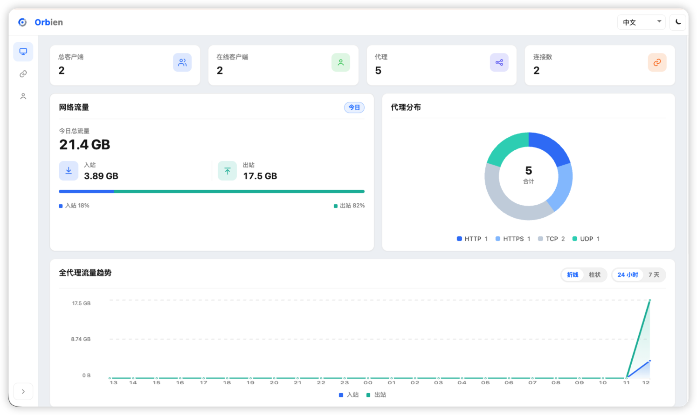

# 管理界面

服务端 Web 管理面板。 `port > 0` 时启用，启用后 **必须** 配置 `user` 与
`password`。



## 示例

```toml
# orbien-server.toml
listen = "0.0.0.0:9527"

[dashboard]
addr = "0.0.0.0"
port = 8020
user = "admin"
password = "123456"

# 可选
# [dashboard.tls]
# certFile = "./certs/dashboard.crt"
# keyFile = "./certs/dashboard.key"
```

浏览器访问 `http://SERVER_IP:8020`（启用 `[dashboard.tls]` 后为 `https://`)。

:::tip
`addr` 默认为 `127.0.0.1`（仅本机），需远程访问时设为 `0.0.0.0`
:::

## 参数

| 参数                     | 必填 | 默认值      | 说明                           |
|--------------------------|------|-------------|--------------------------------|
| `dashboard.addr`         | 否   | `127.0.0.1` | 监听地址；远程访问需 `0.0.0.0` |
| `dashboard.port`         | 是   | `0`         | 监听端口；`0` 表示关闭         |
| `dashboard.user`         | 是   |             | 登录用户名                     |
| `dashboard.password`     | 是   |             | 登录密码                       |
| `dashboard.tls.certFile` | 否   |             | PEM 证书路径                   |
| `dashboard.tls.keyFile`  | 否   |             | PEM 私钥路径                   |

:::info[说明]

- keyFile 和 certFile 必须同时配置才会开启 HTTPS
:::