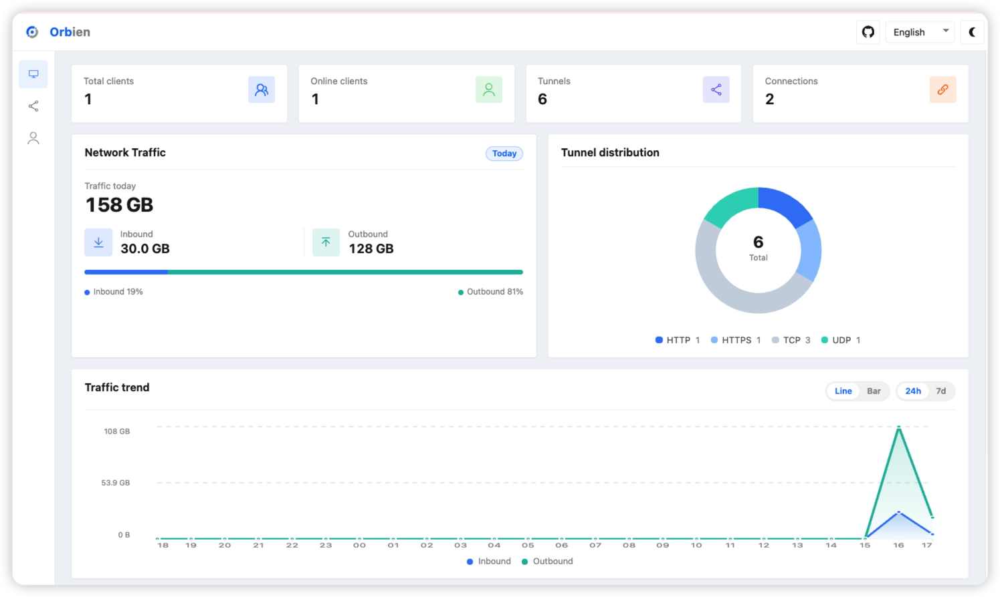

# Dashboard

Server web dashboard. Enabled when `port > 0`; **`user` and `password` are required** once enabled.



## Example

```toml
# orbien-server.toml
listen = "0.0.0.0:9527"

[dashboard]
addr = "0.0.0.0"
port = 8020
user = "admin"
password = "123456"

# Optional
# [dashboard.tls]
# certFile = "./certs/dashboard.crt"
# keyFile = "./certs/dashboard.key"
```

Open `http://SERVER_IP:8020` in a browser (use `https://` when `[dashboard.tls]` is enabled).

:::tip
`addr` defaults to `127.0.0.1` (localhost only). Set it to `0.0.0.0` for remote access.
:::

## Parameters

| Parameter                | Required | Default     | Description                                    |
|--------------------------|----------|-------------|------------------------------------------------|
| `dashboard.addr`         | No       | `127.0.0.1` | Listen address; use `0.0.0.0` for remote access |
| `dashboard.port`         | Yes      | `0`         | Listen port; `0` disables the dashboard        |
| `dashboard.user`         | Yes      |             | Username                                       |
| `dashboard.password`     | Yes      |             | Password                                       |
| `dashboard.tls.certFile` | No       |             | Path to the PEM certificate                    |
| `dashboard.tls.keyFile`  | No       |             | Path to the PEM private key                    |

:::info[Note]

- Both `certFile` and `keyFile` must be set to enable HTTPS
:::
